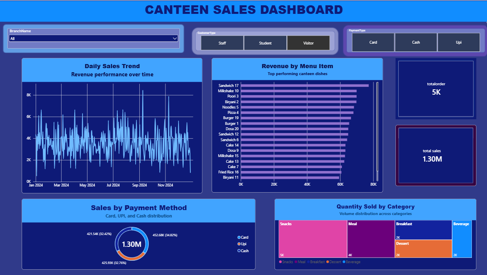

# 🍽️ Canteen Sales & Performance Analytics Dashboard (Power BI)

An end-to-end Power BI business intelligence project analyzing operational sales, customer segments, and revenue streams across campus canteen branches.

---

## 📊 Dashboard Preview



---

## 📌 Project Overview
This project involved ingesting raw multi-table sales data, establishing a normalized Star Schema data model, writing custom DAX measures/columns, and visualizing critical business KPIs to assist canteen operations.

### Key Business Metrics Tracked:
- **Total Sales Revenue:** ₹3.84M
- **Total Order Volume:** 15,000+ orders
- **Key Categories:** Snacks, Meals, Breakfast, Dessert, and Beverages
- **Payment Channels:** UPI, Cash, and Credit/Debit Cards

---

## 🛠️ Data Modeling & DAX Formulas

### Star Schema Architecture
- **Fact Table:** `Fact_Sales`
- **Dimension Tables:** `Dim_Branch`, `Dim_Date`, `Dim_Items`, `Dim_Payment`, `Dim_Staff`

### Core DAX Measures & Columns


Total Orders = COUNTROWS(Fact_Sales)
- **Total Sales:**
  ```dax
  Total Sales = SUM(Fact_Sales[TotalAmount])

  High Order = IF(Fact_Sales[TotalAmount] > 200, "High", "Normal


  Customer Label = 
SWITCH(
    Fact_Sales[CustomerType],
    "Student", "Student Order",
    "Staff", "Staff Order",
    "Visitor", "Visitor Order",
    "Other"
)

Digital Payment = 
IF(
    OR(RELATED(Dim_Payment[PaymentType]) = "UPI", RELATED(Dim_Payment[PaymentType]) = "Card"),
    "Digital",
    "Cash"
)

📈 Visuals & Interactivity
KPI Cards: High-level executive overview of total sales and order count.

Daily Sales Trend (Line Chart): Timeline tracking daily revenue variations.

Top Menu Items (Bar Chart): Breakdown of high-volume and revenue-driving canteen items.

Payment Method Split (Donut Chart): Distribution of digital (UPI/Card) vs cash orders.

Category Volume (Treemap): Volume share across meals, snacks, and beverages.

Interactive Slicers: Dynamic filtering by Branch, Customer Type, and Payment Method.


💻 How to View
Clone or download this repository.

Open Canteen_Sales_Dashboard.pbix using Power BI Desktop.

### Alternative: Upload via Git Command Line (Terminal)

If you have Git installed on your computer:

```bash
git init
git add .
git commit -m "feat: complete canteen power bi project"
git branch -M main
git remote add origin https://github.com/<your-username>/canteen-powerbi-analytics.git
git push -u origin main
